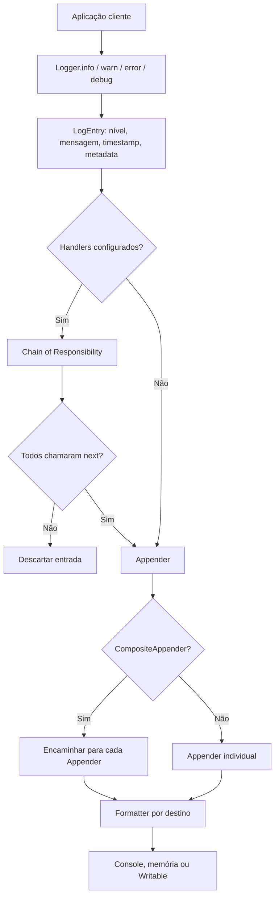

# TraceKit

**Biblioteca extensível de logging in-process para Node.js, escrita em TypeScript.**

A TraceKit permite registrar eventos da aplicação, formatá-los, filtrá-los e encaminhá-los para um ou mais destinos. A biblioteca funciona imediatamente com uma configuração padrão e oferece contratos públicos para quem deseja adicionar formatos, destinos ou critérios de filtragem **sem alterar o código-fonte da TraceKit**.

## 1. Objetivo e escopo

A aplicação cliente não precisa implementar a infraestrutura de logging. Ela importa a TraceKit, instancia um `Logger` e registra mensagens por nível. Caso precise de um comportamento diferente, fornece sua própria implementação de um dos contratos públicos:

- `LogFormatter`: define **como** uma entrada de log é representada como texto;
- `Appender`: define **para onde** a entrada é encaminhada;
- `LogHandler`: define **se** uma entrada deve continuar pela cadeia de processamento.

A TraceKit é uma **biblioteca**, não um servidor, API REST ou aplicação destinada ao usuário final. Sua saída padrão é o console do processo hospedeiro. A implementação não possui dependências de runtime.

### Funcionalidades disponíveis

| Capacidade | Implementação |
|---|---|
| Níveis de logging | `DEBUG`, `INFO`, `WARN`, `ERROR` |
| Logger pronto para uso | `new Logger()` utiliza `ConsoleAppender` + `TextFormatter` |
| Formatação | `TextFormatter`, `JsonFormatter`, ou formatter personalizado |
| Destinos | `ConsoleAppender`, `MemoryAppender`, `StreamAppender`, ou appender personalizado |
| Múltiplos destinos | `CompositeAppender` |
| Configuração fluente | `LoggerBuilder` |
| Filtragem | `LevelFilterHandler`, `PredicateFilterHandler`, ou handler personalizado |
| Integração com Node.js | `StreamAppender` recebe um `Writable` existente |

## 2. Estrutura do projeto

```text
TraceKit/
├── src/
│   ├── index.ts           # API pública
│   ├── log-entry.ts       # Tipos LogLevel e LogEntry
│   ├── logger.ts          # Fachada de uso e coordenação da execução
│   ├── logger-builder.ts  # Montagem de appenders e da cadeia de handlers
│   ├── formatters.ts      # Contrato e estratégias de formatação
│   ├── appenders.ts       # Contrato, classe base e destinos
│   └── handlers.ts        # Contrato e filtros
├── package.json
├── package-lock.json
├── tsconfig.json
└── README.md
```

O TypeScript compila `src/` para `dist/`. A pasta `dist/` é gerada localmente e ignorada pelo Git.

## 3. Instalação e utilização em outro projeto

### Pré-requisitos

- Node.js e npm instalados;
- TypeScript é necessário apenas para **desenvolver/compilar a biblioteca**, não para executar o JavaScript compilado.

No diretório da TraceKit:

```bash
npm install
npm run build
npm pack
```

A configuração atual do pacote define `name: tracekit`, `version: 0.1.0`, `main: dist/index.js`, `types: dist/index.d.ts` e publica apenas `dist/` no pacote. O comando `npm pack` deve gerar `tracekit-0.1.0.tgz`.

Em **outro projeto Node.js**, instale o pacote local gerado:

```bash
npm install /caminho/para/TraceKit/tracekit-0.1.0.tgz
```

O pacote **não está publicado no registro público do npm**. O caminho acima é um exemplo: ajuste-o ao diretório real. Consumidores TypeScript que dependam dos tipos de Node.js podem precisar de `@types/node` em suas dependências de desenvolvimento.

### Uso padrão (out-of-the-box)

```js
const { Logger } = require('tracekit');

const logger = new Logger();
logger.debug('Inicializando aplicação');
logger.info('Pedido recebido', { orderId: 123 });
logger.warn('Estoque baixo');
logger.error('Falha ao processar pagamento');
```

A configuração padrão envia mensagens **em texto** para `console.log`. Os eventos possuem nível, mensagem, timestamp e metadados opcionais. Não existe filtro de nível por padrão: os quatro níveis são registrados.

## 4. Configuração de formatos, destinos e filtros

```js
const {
  LoggerBuilder,
  JsonFormatter,
  MemoryAppender,
  StreamAppender,
  LevelFilterHandler,
} = require('tracekit');

const jsonFormatter = new JsonFormatter();
const memory = new MemoryAppender(jsonFormatter);

const logger = new LoggerBuilder()
  .addAppender(new StreamAppender(process.stdout, jsonFormatter))
  .addAppender(memory)
  .addHandler(new LevelFilterHandler('INFO'))
  .build();

logger.debug('Não passa pelo filtro');
logger.info('Pagamento confirmado', { orderId: 123 });

console.log(memory.getMessages());
```

**Como esse código funciona:** o Builder cria internamente um `CompositeAppender`, porque foram adicionados dois destinos. O `LevelFilterHandler` interrompe o fluxo para entradas abaixo de `INFO`. Uma mensagem aprovada é encaminhada a ambos os appenders; cada um aplica seu próprio formatter. `MemoryAppender.getMessages()` retorna uma cópia das strings armazenadas.

### Filtro personalizado

```js
const { LoggerBuilder, PredicateFilterHandler } = require('tracekit');

const logger = new LoggerBuilder()
  .addHandler(new PredicateFilterHandler(entry => entry.message.includes('pedido')))
  .build();

logger.info('pedido criado');      // encaminhado ao console padrão
logger.info('sessão iniciada');    // ignorado
```

Os handlers executam **na ordem em que são adicionados**. Cada handler pode chamar `next()` para continuar ou deixar de chamá-lo para interromper o fluxo.

## 5. Extensibilidade: código do consumidor

O requisito central do trabalho é permitir novos comportamentos **sem modificar a biblioteca**. Por exemplo, o consumidor pode fornecer seu próprio formatter:

```js
const { LoggerBuilder, MemoryAppender } = require('tracekit');

class CompactFormatter {
  format(entry) {
    return `${entry.level} | ${entry.message}`;
  }
}

const memory = new MemoryAppender(new CompactFormatter());
const logger = new LoggerBuilder().addAppender(memory).build();
logger.info('Operação concluída');

console.log(memory.getMessages());
// ['INFO | Operação concluída']
```

É possível também criar appenders e handlers sem alterar `src/`:

```js
const { LoggerBuilder } = require('tracekit');

const received = [];
const customAppender = { append(entry) { received.push(entry); } };
const customHandler = {
  handle(entry, next) {
    if (entry.metadata?.audit === true) next();
  },
};

const logger = new LoggerBuilder()
  .addAppender(customAppender)
  .addHandler(customHandler)
  .build();

logger.info('Auditoria', { audit: true });
logger.info('Evento comum');
console.log(received.length); // 1
```

A API pública é exportada por `src/index.ts`. Como TypeScript utiliza contratos estruturais, o objeto fornecido pelo consumidor precisa cumprir os métodos exigidos, independentemente de herdar de uma classe interna.

## 6. Fluxo de uma entrada de log



O `Logger` cria o `LogEntry` e coordena a execução, mas **não sabe formatar mensagens nem como cada destino persiste ou apresenta seus dados**. O `LoggerBuilder` apenas constrói e conecta os componentes; não registra mensagens.

## 7. Design Patterns implementados

| Padrão | Local no código | Problema de design resolvido |
|---|---|---|
| **Strategy** | `LogFormatter`, `TextFormatter`, `JsonFormatter` — `src/formatters.ts` | Substituir a estratégia de formatação sem alterar os appenders. |
| **Template Method** | `BaseAppender.append()` e `write()` — `src/appenders.ts` | Centralizar o algoritmo de formatação + escrita e especializar somente a saída. |
| **Composite** | `CompositeAppender` — `src/appenders.ts` | Tratar vários destinos pelo mesmo contrato de um destino individual. |
| **Builder** | `LoggerBuilder` — `src/logger-builder.ts` | Construir uma configuração opcional e fluente, sem sobrecarregar a API do `Logger`. |
| **Chain of Responsibility** | `LogHandler`, filtros e encadeamento com `next()` — `src/handlers.ts`, `src/logger-builder.ts` | Executar uma sequência ordenada de verificações com interrupção antecipada. É uma variante baseada em callbacks. |
| **Adapter** | `StreamAppender` — `src/appenders.ts` | Adaptar a interface `Writable.write()` do Node.js ao contrato `Appender.append()`. |

### Por que esses padrões fazem sentido juntos?

Eles resolvem **problemas diferentes** do mesmo fluxo. Strategy determina como formatar; Template Method reaproveita o algoritmo dos destinos textuais; Composite distribui para vários destinos; Builder monta a configuração; Chain of Responsibility decide quais eventos prosseguem; Adapter integra um componente externo com interface incompatível. Nenhum deles exige modificar o Logger para incluir um novo formato, filtro ou destino.

## 8. Princípios de design e decisões conscientes

- **Open/Closed Principle:** formatter, appender e handler podem ser implementados pelo consumidor. O núcleo permanece inalterado.
- **Single Responsibility Principle:** `Logger` cria e encaminha eventos; formatadores serializam; appenders fazem a saída; handlers filtram; Builder conecta componentes.
- **Dependency Inversion:** `Logger` recebe contratos (`Appender` e `LogHandler`), não depende diretamente de destinos específicos. O padrão pronto para uso injeta `ConsoleAppender` por default.
- **Composição sobre herança:** `CompositeAppender` e a cadeia de callbacks compõem comportamentos. Herança é utilizada especificamente em `BaseAppender` para implementar Template Method.
- **Clean Code:** nomes descritivos, código segmentado por responsabilidade, tipos explícitos para níveis e métodos públicos pequenos.

### Limites deliberados desta versão

A TraceKit **não** implementa rotação de arquivos, envio remoto, escrita assíncrona, tratamento avançado de falhas, política de `backpressure`, mascaramento automático de dados sensíveis ou configuração por arquivo. O `StreamAppender` não encerra automaticamente o stream; o ciclo de vida do `Writable` é responsabilidade do consumidor. Erros de formatação/appenders podem propagar-se ao chamador. Esses pontos foram mantidos fora do escopo para atender ao objetivo de uma biblioteca acadêmica pequena e extensível.

## 9. Compilação e verificação manual

```bash
npm install
npm run build
npm pack --dry-run
```

## 10. Equipe e apresentação

**Integrantes**

- Integrante 1: **Gustavo Henrique Schott** — Strategy e Template Method.
- Integrante 2: **Milena Ferraz** — Composite e Builder.
- Integrante 3: **Diego Santos** — Chain of Responsibility e Adapter.

**Vídeo de apresentação (YouTube):** **(placeholder)**

**Entrega:** um único link para o repositório. O repositório deve estar acessível ao professor; atualmente, a visibilidade do `gxot/TraceKit` é privada.
